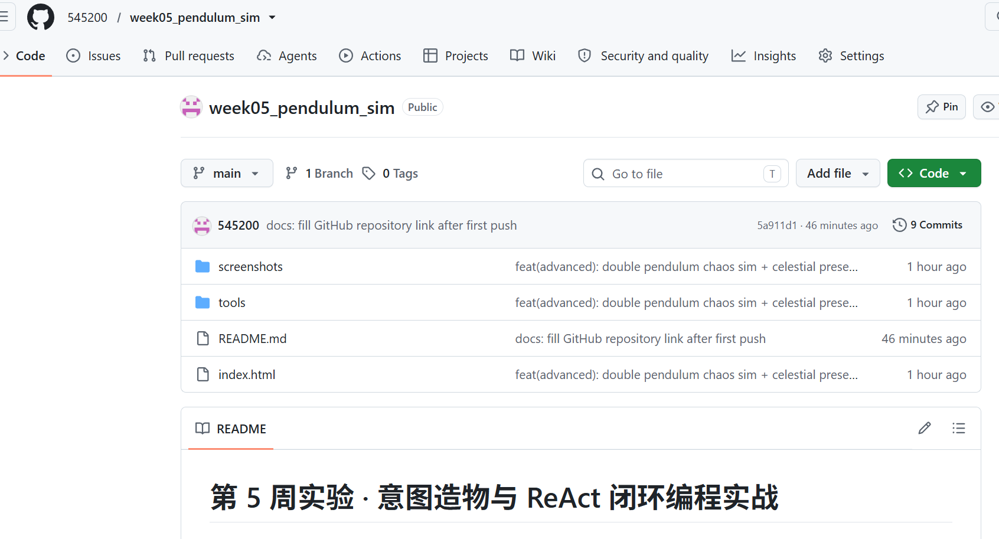

# 第 5 周实验 · 意图造物与 ReAct 闭环编程实战

从结构化意图到可运行的交互世界 —— 单摆 / 双摆物理模拟器

## 一、运行方式

双击 `index.html` 即可在浏览器中运行，无需任何依赖、构建步骤或本地服务器。

## 二、功能清单

### 基础功能（对应任务二、任务三）

- 单摆物理模拟：Canvas 绘制，`requestAnimationFrame` 驱动，深灰科技底色 + 发光摆球
- 摆长滑块（100~350px）、重力滑块（1~25）、空气阻尼滑块（0.000~0.010），实时联动
- "重置摆动"按钮：摆球精准回到 45° 静止初始态，控制台 0 报错

### 进阶挑战（任务五，A + B 均已实现）

- **A · 双摆混沌模拟器**：拉格朗日方程 + 四阶 Runge-Kutta 数值积分（每帧 8 子步），
  第二摆球带半透明彩虹渐变衰减拖尾，支持鼠标直接拖拽任一摆球改变初始角度
- **B · 天体场景与持久化**：地球 9.8 / 月球 1.62 / 木星 24.79 / 太空 0.5 四个胶囊按钮，
  重力平滑过渡并联动滑块；自定义参数经 `localStorage` 自动保存，刷新后完整恢复
- 摆长超出画布时自动等比缩放，长摆不出界；HUD 实时显示模式 / 摆角 / 周期 / 重力

## 三、目录结构

```
week05_pendulum_sim/
├── index.html                        # 单文件应用（最终交付物）
├── README.md                         # 本报告：三反思 + 提交记录
├── screenshots/
│   ├── 01-single-pendulum.png        # 单摆运行截图（地球 / 200px）
│   └── 02-double-pendulum.png        # 双摆运行截图（木星 / 彩虹拖尾）
├── tools/
│   └── acceptance_check.js           # 自动化验收脚本（CDP 驱动无头浏览器）
```

## 四、Git 提交记录（时间倒序）

```text
01c0d9c chore: drop buggy practice stub from deliverable
634aef1 docs: finalize README with HOTL reflections and acceptance report
b944896 feat(advanced): double pendulum chaos sim + celestial presets + persistence
6d694f9 fix: resolve reset button runtime error
637b655 feat: add interactive parameter sliders
9fbbcbe feat: complete pendulum MVP
cd9f0b0 feat(week05): init pendulum experiment workspace
```

> 完整历史可在项目目录执行 `git log --oneline` 查看。

GitHub 仓库链接：**https://github.com/545200/week05_pendulum_sim**

远端同步状态：已成功 `push` 至 `origin/main`，本地 `main` 分支已跟踪远端。



## 五、ReAct 闭环自愈实录（任务四证据链）

1. **Action**：在交互基线版本（commit `637b655`）点击"重置摆动"按钮
2. **Observation（真实控制台红字，无头浏览器 CDP 捕获）**：

   ```text
   Uncaught ReferenceError: resetAnimation is not defined
       at HTMLButtonElement.onclick (index.html:124:66)
   ```

3. **Reflection（根因定位，两层叠加）**：
   - 命名不一致：HTML 内联 `onclick="resetAnimation()"` 调用的函数名，与实际声明的
     `resetSimulationState` 不匹配；
   - 作用域隔离：所有逻辑封装在 IIFE 内，即使改名，内联 onclick 在全局作用域也找不到该函数。
4. **Action（外科手术式修复）**：删除内联 onclick，改在 IIFE 内部用
   `addEventListener('click', resetSimulationState)` 绑定，名称与作用域同时对齐，
   不引入任何全局变量；并顺手重置了动画时间基准避免首帧 dt 突增。
5. **验收**：自动化验收脚本确认点击重置后摆角精确回到 45.0°，控制台 0 报错。

## 六、自动化验收数据摘要

使用 `tools/acceptance_check.js`（Chrome DevTools Protocol 驱动无头 Edge）实测：

| 验收项 | 实测结果 |
| --- | --- |
| 冷启动渲染（L=200px） | 摆球距悬点 199.7px，正常摆动 |
| 摆长滑块 → 350px | 实测 349.8px，标签同步 "350 px" |
| 双摆切换 | RK4 积分持续运行 3s+，无数值发散（无 NaN 画面） |
| 月球预设 | 重力标签 1.62，胶囊高亮正确 |
| 单摆模式点击重置 | 摆角 45.0°，静止初始态恢复 |
| 刷新后持久化 | 长度 275px / 重力 1.62 / 模式均从 localStorage 完整恢复 |
| 控制台 | 0 异常、0 错误日志 |

## 七、人机协同三反思

### 1. 意图清晰度反思

任务三做增量演进时，我的提示词只写了"增设重置摆动按钮，点击后摆球精准回到 45 度"，
**缺少了约束（Boundary）里对事件绑定方式与函数作用域的规范，也漏掉了验收标准中
"点击后控制台 0 报错"这一条**。结果 AI 用了内联 `onclick="resetAnimation()"`，
函数却声明为 `resetSimulationState` 且藏在 IIFE 里，一点就抛 ReferenceError。
后来我把两条都补进提示词：约束里明确"事件绑定必须用 addEventListener，不引入全局函数"，
验收标准里加上"点击重置后控制台 0 报错"，并要求修复必须基于报错堆栈而非凭感觉重写。
这次教训让我体会到：漏掉的每一条约束，最后都会变成一次返工。

### 2. 闭环控制反思

遇到报错时我没有说"怎么坏了，重写一遍"，而是按 F12 复制完整红字堆栈喂给 AI。
堆栈里 `resetAnimation is not defined at HTMLButtonElement.onclick (index.html:124:66)`
直接把问题钉死在事件绑定的调用点。AI 的 Reflection 给出两层根因：函数名不一致 +
IIFE 作用域隔离，修复方案没有动任何物理公式——因为它判断这不是物理层问题，
而是事件绑定层的作用域边界问题，改用 addEventListener 一次性修好。
我完全看懂并认可这个修复：它改的是"边界条件"（谁能访问到这个函数），而不是盲目重构。
另一次闭环是双摆数值发散风险：AI 主动提出 RK4 + 每帧 8 子步的方案，我用自动化脚本
让双摆持续跑了 3 秒以上验证画面无 NaN、轨迹连续，确认边界条件成立后才合入。

### 3. 主体地位确认

**由我决定的核心决策**：物理单位约定（100px = 1m）与阻尼系数的视觉放大倍率；
整体视觉风格、面板布局与配色；功能优先级与进阶挑战"两个都做"的取舍；
每一条验收标准；以及最终"能不能交付"的裁判结论（我用自动化验收脚本当裁判，
但判定标准由我制定）。

**由 AI 完成的重复劳动**：拉格朗日双摆方程的推导与展开、RK4 积分器样板实现、
Canvas 分层渲染与拖尾渐变的大量绘制代码、事件监听与 localStorage 读写样板、
截图与验证脚本的协议细节。我提出意图、设边界、看效果、给反馈；
AI 把意图翻译成正确的语法与数学细节。人负责"做对的事"，AI 负责"把事做对"。

## 八、提交自检清单

- [x] 双击 `index.html` 可在浏览器中正常流畅运行
- [x] F12 检查 Console 控制台 0 红色报错（自动化验收实测通过）
- [x] README.md 已完整填写"人机协同三反思"
- [x] 已执行 `git push` 推送到 GitHub 个人作品集：https://github.com/545200/week05_pendulum_sim
- [x] 已将仓库归档打包为标准 Zip 格式（`Week05_Lab_7112124044张仁红.zip`）
